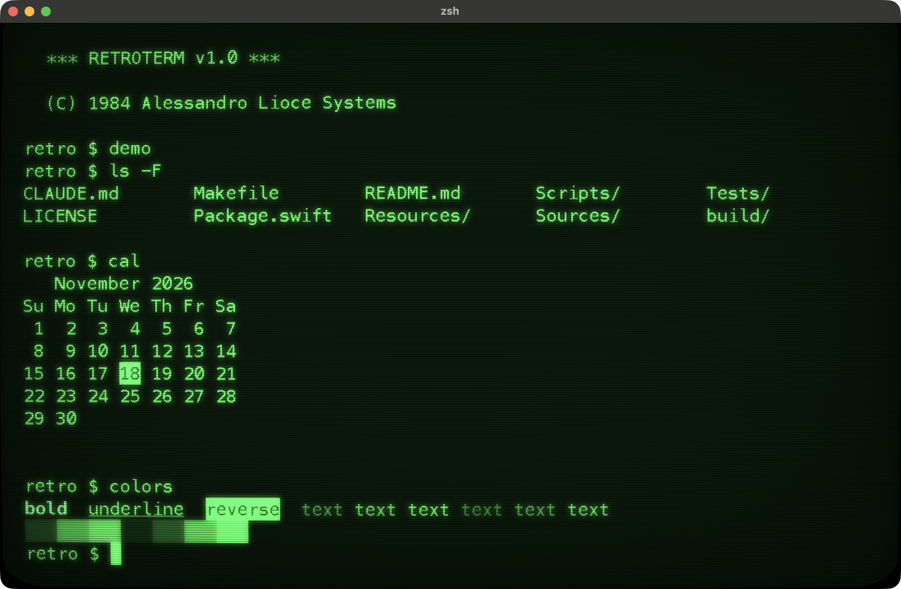
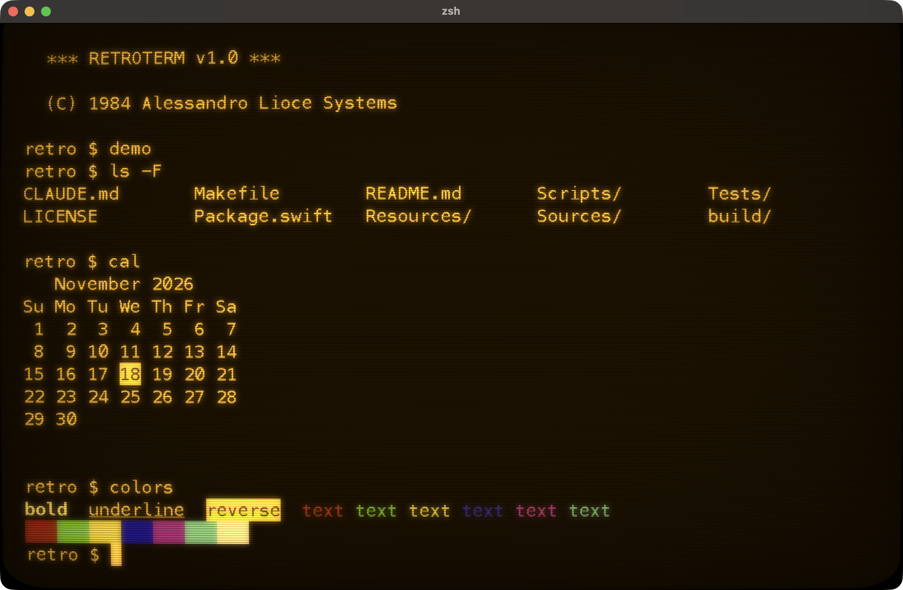
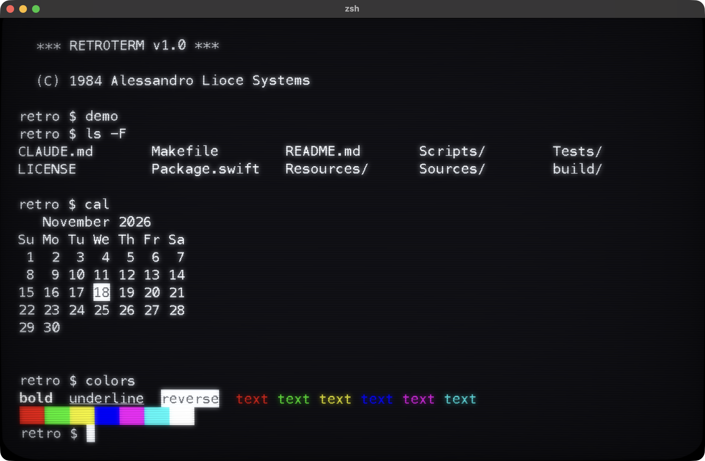
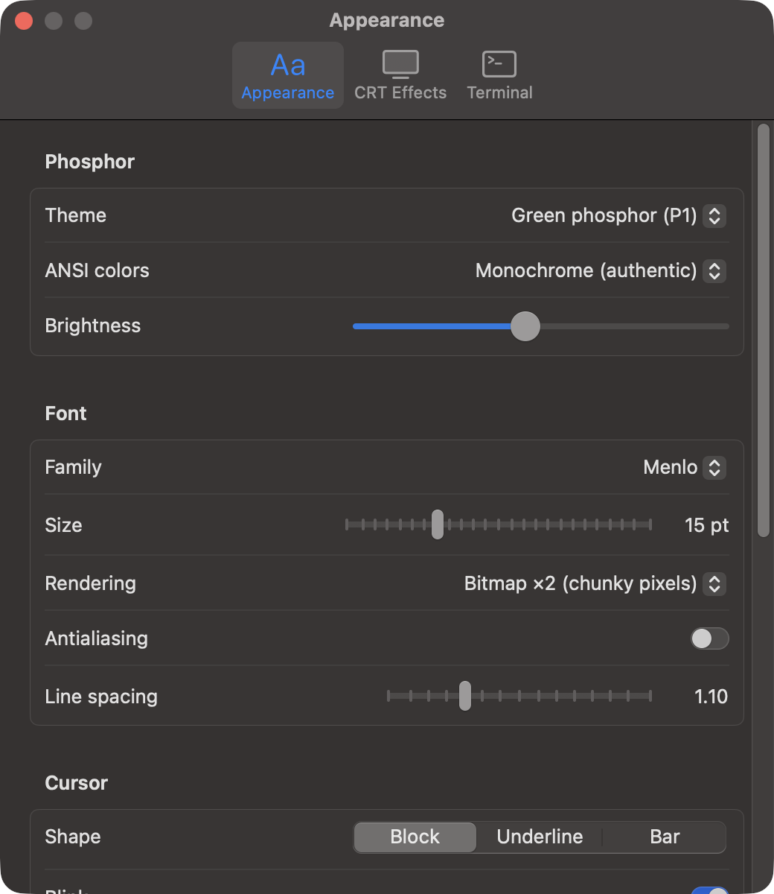
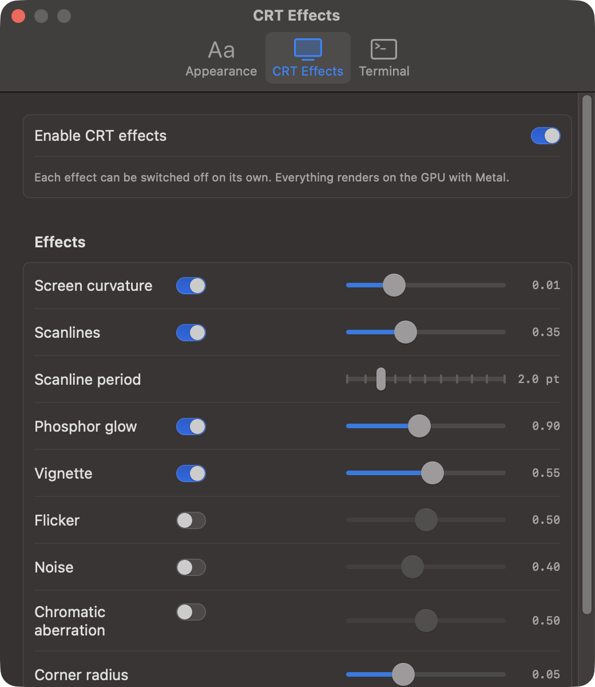
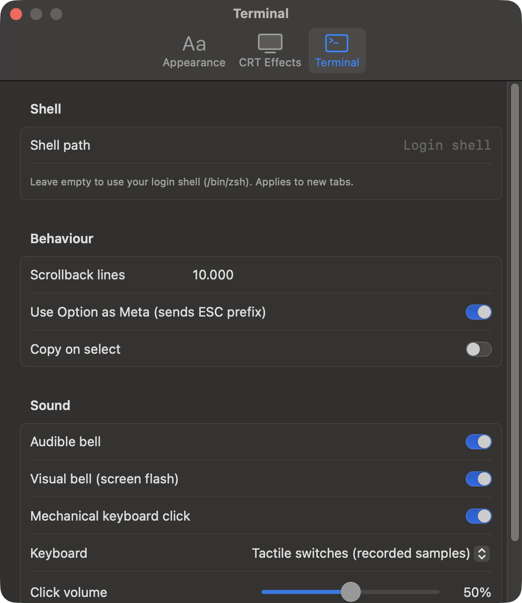

# RetroTerm

A terminal emulator for macOS that looks like a 1980s CRT monitor. Green, amber or white phosphor, curved glass, scanlines and glow, chunky bitmap text and the click of a mechanical keyboard, around a real VT100/xterm emulator running your own shell. Everything is rendered on the GPU with Metal, and every effect can be turned off on its own.

<p align="center">
  
</p>

## Features

- **CRT picture**: screen curvature, scanlines, phosphor glow, vignette, flicker, noise, chromatic aberration and rounded corners, each with its own switch and intensity. ⌘⇧E turns the whole lot off and on.
- **Phosphors**: green (P1), amber (P3), white (P4), the light-blue-on-blue of a Commodore 64, or your own colours. Colour mode can be authentic monochrome, ANSI colours tinted by the phosphor, or full ANSI colours.
- **Bitmap text**: any monospace font, rasterised at a reduced size and magnified 2×, 3× or 4× for chunky pixels, or drawn at native resolution. Antialiasing is optional.
- **Fixed grid**: keep a classic 80×24 (or any size) and scale the picture to the window, stretched or with its aspect ratio kept, so a full-screen window fills like the raster of a real monitor. Or let the grid reflow with the window, like any other terminal.
- **A real terminal**: VT100/xterm emulation with scrollback, scroll regions, SGR colours and attributes, wide characters, bracketed paste, application cursor keys, OSC title, working directory and clipboard, Option as Meta.
- **Tabs**: new tabs open in the working directory of the shell you are in.
- **Mechanical keyboard click**, on by default: recorded tactile-switch samples, deeper for Space, Return and modifiers, or a synthesised click. Volume control in Preferences.
- **Boot banner** printed in every new tab before the shell starts, with editable text. Audible and visual bell, block, underline or bar cursor with optional blink, copy on select.
- Native Swift, no third-party dependencies, no network access.

## Screenshots

Amber phosphor with ANSI colours tinted by the phosphor, and white phosphor with full ANSI colours:

| Amber (P3), tinted colours | White (P4), full colours |
|---|---|
|  |  |

## Requirements

macOS 14 or later, on Apple Silicon or Intel.

## Usage

RetroTerm opens a window with your login shell. Open **Preferences** (⌘,) to pick the phosphor, the font and the effects; the **View** menu has the text size, the CRT effects toggle and the window resize mode.

| Shortcut | Action |
|---|---|
| ⌘T · ⌘W · ⌘⇧W | New tab · close tab · close window |
| ⌘⇧] · ⌘⇧[ · ⌘1…⌘9 | Next, previous, numbered tab |
| ⌘K | Clear screen and scrollback |
| ⌘+ · ⌘- · ⌘0 | Bigger, smaller, default text size |
| ⌘⇧E | CRT effects on and off |
| ⌃⌘F | Full screen |
| ⌘Home · ⌘End · ⌘PgUp · ⌘PgDn | Scroll |
| ⌘, | Preferences |

## Settings

Preferences has three tabs:

- **Appearance**: phosphor and brightness; font, size, pixel scale, antialiasing and line spacing; cursor shape and blink; screen margin, fixed grid size, tab bar, boot banner.
- **CRT Effects**: the master switch and one row per effect, with its intensity; scanline period and corner radius.
- **Terminal**: shell path (empty means your login shell), scrollback lines, Option as Meta, copy on select; audible and visual bell, keyboard click sound and volume.

| Appearance | CRT Effects | Terminal |
|---|---|---|
|  |  |  |

Settings are stored in the app's user defaults and survive upgrades: a setting the running version does not know is ignored, a missing one keeps its default.

## Build from source

Requires the Swift 5.9 toolchain or later. The Xcode Command Line Tools are enough to build and run; the tests need Xcode, because XCTest is not part of the Command Line Tools.

```sh
git clone https://github.com/slioce/RetroTerm.git
cd RetroTerm
make install   # builds, copies to /Applications and launches
make run       # launches the build without installing it
make test      # runs the emulator tests
make debug     # debug build, packaged as build/RetroTerm.app
```

There is no Xcode project: `swift build` compiles the package and `Scripts/build-app.sh` wraps the binary, `Info.plist`, icon and sounds into `build/RetroTerm.app`, ad-hoc signed for local use. If `swift test` cannot find XCTest, point it at Xcode: `DEVELOPER_DIR=/Applications/Xcode.app/Contents/Developer swift test`.

## Project layout

```
Sources/CPTY/           C shim: forkpty, window size, working directory of a process. Nothing else is C.
Sources/RetroTermCore/  The emulator: VT parser, terminal state, PTY, key encoding, character widths. No AppKit, testable headlessly.
Sources/RetroTerm/      The app: windows and tabs, input, Metal renderer and shaders, glyph atlas, keyboard sound, preferences.
Tests/                  Emulator tests: printing, wrapping, scroll regions, SGR, wide characters, split UTF-8, resize.
Resources/              Info.plist, entitlements, icon, keyboard samples with their attributions.
Scripts/                App packaging, notarisation, icon generation.
```

The emulator is a state machine fed with bytes and unaware of the PTY; it reports to the app only through callbacks. The app renders a snapshot of the visible lines in three Metal passes: the text grid from a glyph atlas, a bloom pass for the glow, and the CRT composite that warps, masks and scans the picture.

## Publishing

RetroTerm is distributed outside the Mac App Store, with Developer ID signing and notarisation: a terminal that runs your shell cannot live in the App Sandbox, which the store requires. Without a signing identity the build is ad-hoc signed, fine on your own Mac, but Gatekeeper will stop it on others.

1. Create a *Developer ID Application* certificate in Xcode or the developer portal and install it in your keychain.
2. Store the notarisation credentials once, with an app-specific password from appleid.apple.com:

   ```sh
   xcrun notarytool store-credentials "RetroTerm" --apple-id you@example.com --team-id TEAMID
   ```

3. Build, sign, notarise and staple:

   ```sh
   SIGN_IDENTITY="Developer ID Application: Your Name (TEAMID)" make dmg
   ```

   The result is `build/RetroTerm-<version>.dmg`, ready to attach to a GitHub release.

The app is signed with the hardened runtime and an empty entitlements file: no sandbox, nothing relaxed. Keep it that way: no JIT, no unsigned libraries. Bundled assets must stay under permissive licences.

## Privacy

Everything happens on your Mac. RetroTerm has no network access, collects no data, and keeps nothing but its settings.

## Acknowledgements

The keyboard samples are CC0 recordings from [Freesound](https://freesound.org) by StavSounds and Capt.Jack; the full list is in [`Resources/Sounds/Tactile/README.md`](Resources/Sounds/Tactile/README.md). RetroTerm was written with the help of AI coding agents; design, review and testing are the author's.

## License

Copyright © 2026 Alessandro Lioce. RetroTerm is free software, released under the [GNU General Public License v3.0](LICENSE) or any later version.
